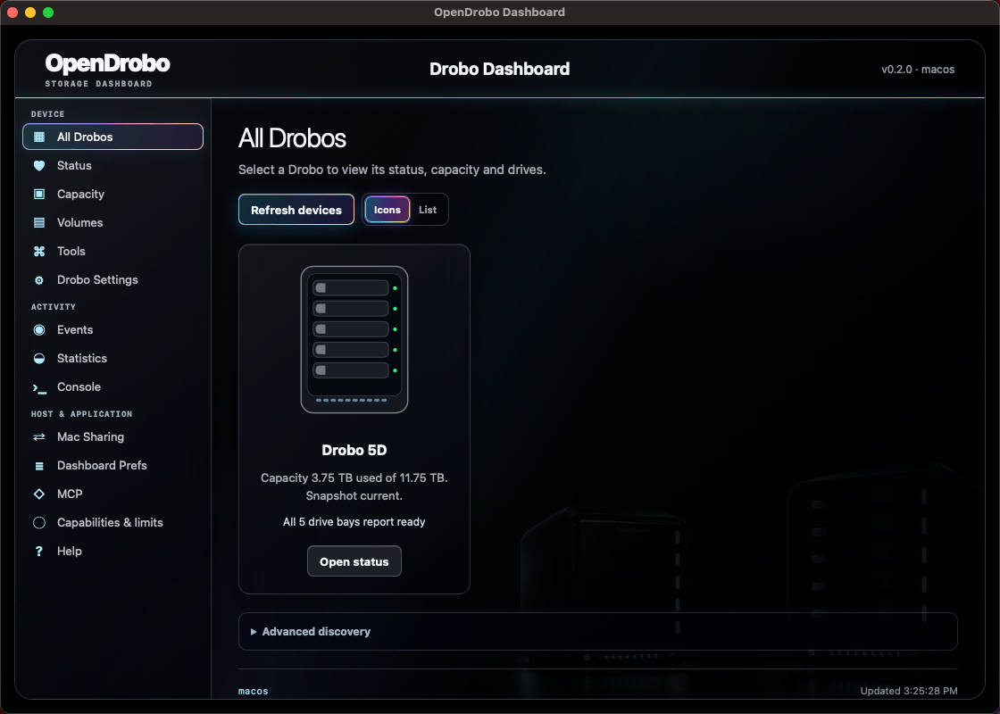
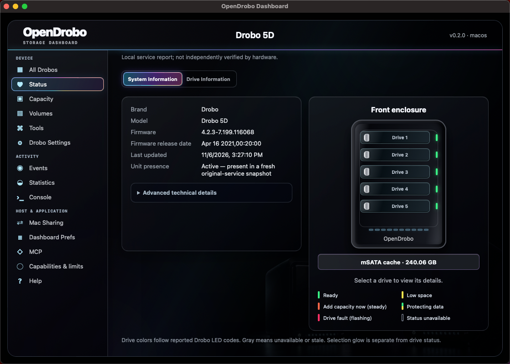
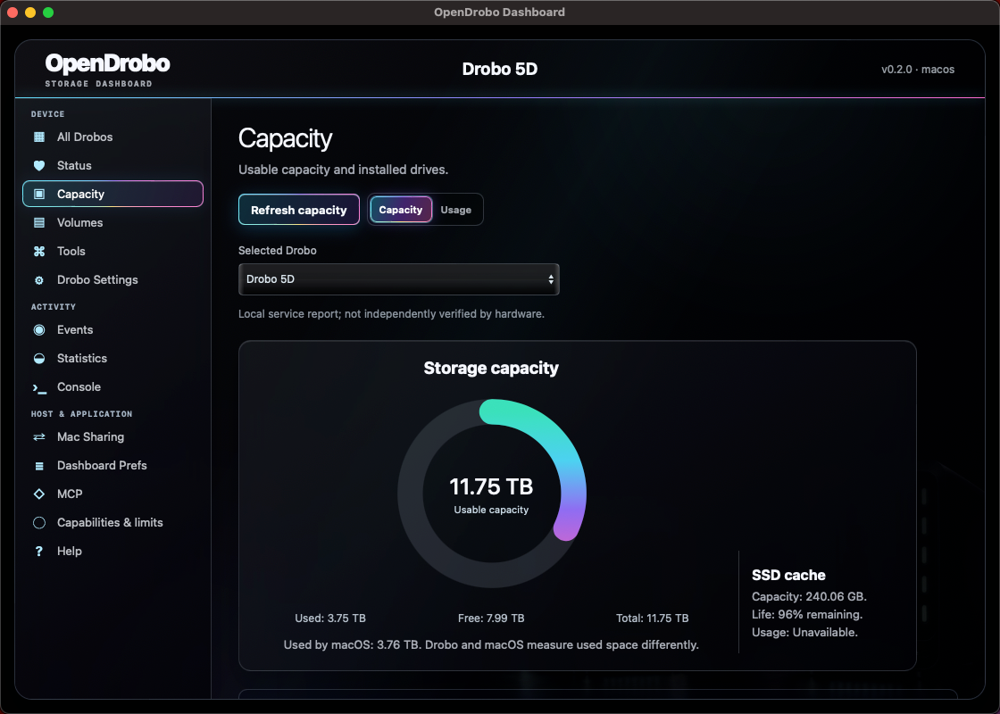
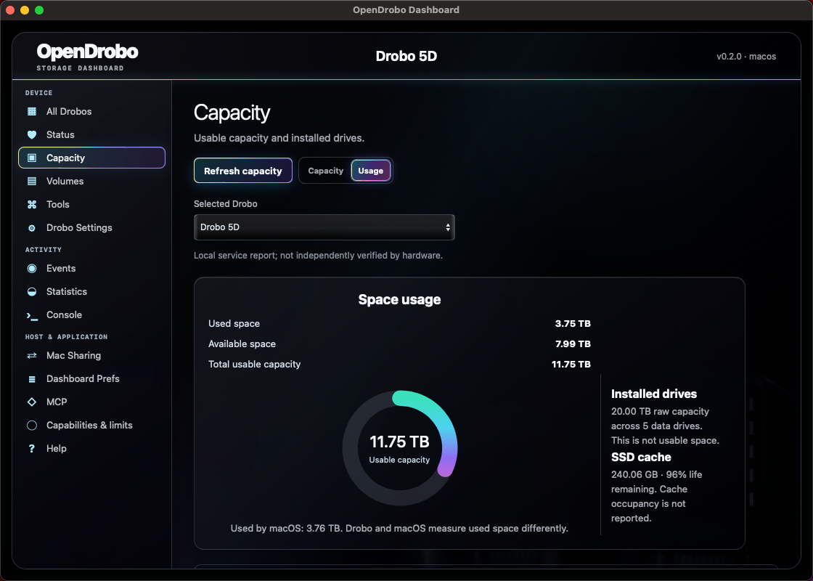
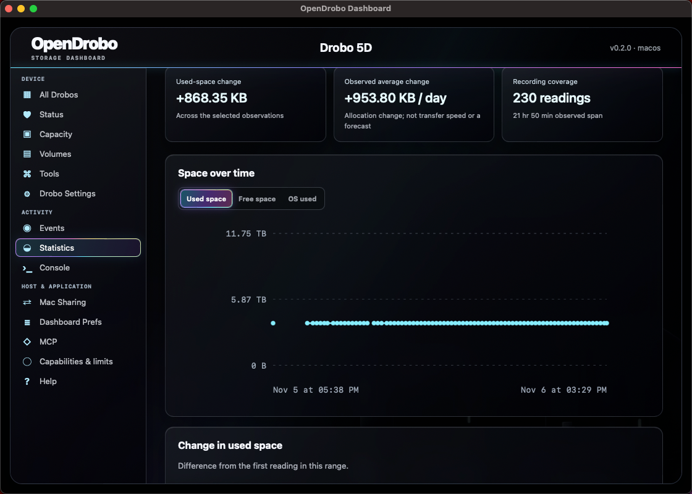
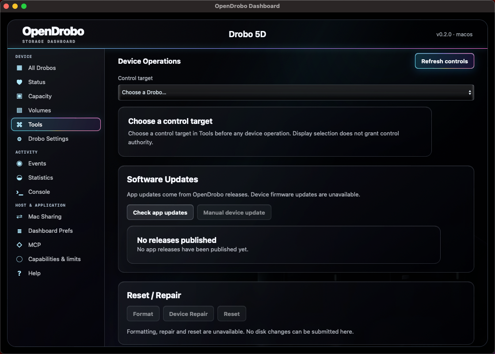

# OpenDrobo

OpenDrobo is an independent desktop dashboard for Drobo storage. See your enclosure, drive bays, usable capacity, mounted volumes and storage activity in one dark interface.

## App screenshots

Current macOS preview with a connected Drobo 5D. These are actual app captures; capacity and history reflect that unit's observations. Click an image to view it at full size.

| All Drobos | Status |
| --- | --- |
| [](docs/screenshots/all-drobos.png) | [](docs/screenshots/status.png) |
| **Capacity** | **Usage** |
| [](docs/screenshots/capacity.png) | [](docs/screenshots/usage.png) |
| **Statistics** | **Tools** |
| [](docs/screenshots/statistics.png) | [](docs/screenshots/tools.png) |

Screenshots show the current preview, including unavailable operations. See [capture details](docs/screenshots/README.md) and [compatibility](#compatibility) before choosing hardware or relying on a feature.

## Your storage at a glance

- One enclosure per Drobo, with automatic selection when only one unit is connected.
- Interactive enclosure graphics with matching drive-bay lights and a compact color-bar legend. Steady capacity warnings, flashing drive faults and data protection have distinct explanations.
- An RGB capacity ring with a transparent unused track, plus clear usable, used and free measurements. Raw drive capacity and macOS filesystem usage stay separate.
- A tidy volume list with native Mac icons, filesystem, mount location, permissions and enclosure grouping.
- Drive make/model, firmware and SSD capacity/life when the device reports them.
- Capacity history, charts, observation gaps, events and a bounded application console.
- A three-second artwork splash with immediate skip, matching application icons and menu-bar shortcuts for dashboard pages, read-only refresh, hide/show and quit.
- Native Mac sharing visibility and a shortcut to File Sharing settings. macOS accounts and folder permissions remain authoritative.
- Optional read-only MCP access for a trusted local assistant or script. See the [MCP guide](docs/MCP.md).

Closing the dashboard window leaves OpenDrobo available in the menu bar. Use Quit in its menu to exit. Menu shortcuts open pages and refresh read-only information; device actions remain inside Tools.

The dashboard can show model-specific light and power controls with explicit selection and safety checks. Live control validation remains pending on a separate disposable test unit.

## Compatibility

The desktop app targets macOS 14 or later. A Drobo 5D over Thunderbolt has been observed on an Intel Mac running macOS 14.7.7. Apple-silicon packages build, but device connectivity on Apple silicon remains unverified. The original Drobo management driver is required.

HFS+ and APFS volumes are visible when macOS mounts them and their Drobo binding is verified. Non-Drobo volumes and unrelated network shares are excluded. Linux and Windows device adapters, other array providers and additional filesystem support remain future work; see the [support matrix](docs/STORAGE_SUPPORT.md).

## Capacity and data safety

Drobo's logical volume ceiling can be much larger than its installed usable capacity. OpenDrobo shows Drobo usable capacity and macOS filesystem usage separately. It does not change Finder's capacity reporting or rewrite filesystem geometry.

OpenDrobo does not currently assemble BeyondRAID member disks, reconstruct or repair an array, format a disk pack, reset a unit, or update firmware. These capabilities require further research and disposable-hardware validation. The [spare-unit lab guide](docs/SPARE_UNIT_LAB.md) prepares an offline test plan without running hardware operations.

## Releases and building

The release channel is [OpenDrobo on GitHub](https://github.com/hypler-dev/OpenDrobo/releases). Signing, hardware certification and release gates are tracked in [v1.0 readiness](docs/V1_READINESS.md).

To build locally with the pinned toolchain:

```sh
npm --prefix desktop ci
make check
make build
open dist/OpenDrobo.app
```

Local builds use optimized code and ad-hoc signing; they are not notarized distribution releases. App update checks open verified project release pages and do not download or install software automatically.

Trusted tester builds can use macOS's per-app approval when available, without a paid developer membership. See the [local/tester instructions](docs/RELEASING.md#local-and-tester-builds-without-membership); the public v1.0 release retains its signing and notarization gates.

Read the [management guide](docs/MANAGEMENT_FEATURES.md) for dashboard features, the [developer guide](docs/DEVELOPER_GUIDE.md) for architecture and contribution details, and the [release guide](docs/RELEASING.md) for distribution checks.

OpenDrobo is not affiliated with Drobo. Public builds exclude vendor binaries, firmware, extracted vendor artwork, credentials and private diagnostic captures. The gallery contains selected app-window screenshots only.
