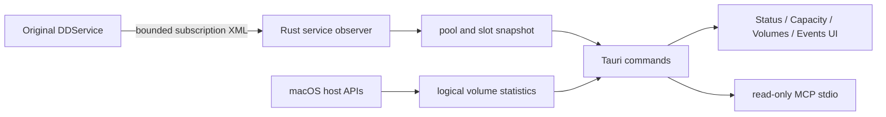

# Developer guide

## Architecture

OpenDrobo uses portable Rust core and Tauri 2 desktop shell.

- `crates/opendrobo-core/`: portable capacity, transport, and bounded binary decoders.
- `crates/opendrobo-probe/`: file-only inspection CLI for copied transport or RMR evidence.
- `desktop/src-tauri/`: Rust commands, original-service observer, diagnostics, host storage/sharing inspection, updates, and MCP stdio server.
- `desktop/src/`: shared TypeScript/CSS interface.
- `platform/macos/transport/`: C bridge for original macOS user-client path.
- `platform/macos/fskit/`: separate read-only FSKit research module; inactive and macOS 26-specific.
- `platform/macos/driverkit/`: non-activated DriverKit/SCSI research implementation and sanitizer checks.
- `research/`: recovered ABI, transport, RMR, and reverse-engineering notes. Vendor inputs and raw captures stay ignored.

Data flow is intentionally one-way for management reads:



The original service owns transient listener registration. OpenDrobo does not stop or restart that service. A read observer has no array-write path, but registration itself is not equivalent to zero service-side state.

The command boundary is fixed: GUI controls call typed allowlisted operations; MCP reports availability only. No UI field becomes arbitrary XML, CDB, shell, or filesystem input. The recovered transport and management ABI evidence is indexed from [research/MACOS_MANAGEMENT_ABI.md](../research/MACOS_MANAGEMENT_ABI.md) and [research/THUNDERBOLT_TRANSPORT.md](../research/THUNDERBOLT_TRANSPORT.md).

Current macOS service observer connects only to original local management service on loopback port 4502. It uses bounded subscription frames and strict XML validation. It groups service updates into protected pool with logical volumes and separate physical slots. Internal service identifiers are correlation data only and never returned as serials or credentials.

Volume icons are read at runtime through [NSWorkspace iconForFile](https://developer.apple.com/documentation/appkit/nsworkspace/icon(forfile:)) and encoded as bounded 48-pixel PNGs; no Apple icon files are distributed.

Volume and sharing adapters apply Drobo binding before returning records. Volume records are limited to verified Drobo-mounted paths. SMB exports are listed only when their configured paths fall under those Drobo mount roots with component boundaries; this lexical classification does not resolve symlink targets and grants no file access; SMB/NFS service status describes the host service. Native accounts, permissions, and ACLs remain OS-owned and are not modified. Non-Drobo volumes and unrelated share points are intentionally omitted.

## Build and test

Requirements: macOS 14+ for the desktop app, pinned Rust 1.98.0 and Node 24.22.1, npm and Python 3.11+. The validated host uses Xcode 26.3 (17C529). Native DriverKit/FSKit checks use the installed SDKs; see [release preparation](RELEASING.md). The workspace’s declared Rust 1.85 minimum is distinct from the tested build pin.

```sh
npm --prefix desktop ci
make check
make build
```

`make check` currently runs 24 lanes: Rust tests, frontend type/build checks, desktop policy tests, exact-capacity statistics, Status-selection/identity, drive-indicator and usage/volume-grouping behavior suites, native icon rendering/binding-bound checks, native transport sanitizer checks, DriverKit policy checks, and direct FSKit checks. These tests do not activate a driver, mount a filesystem, or send commands to a Drobo.

The default optimized package targets macOS 14 on either architecture and excludes FSKit and extracted vendor artwork. Default UI resources use newly rendered OpenDrobo art and independently authored live enclosure graphics. Private builds may explicitly package ignored legacy files with `--local-artwork`, but normal UI no longer references them. Decorative artwork lights are not telemetry. The optional FSKit module and its direct checks require macOS 26 SDK/runtime support; it remains inactive. Build and test the app14 path separately from the FSKit research path.

For an Intel macOS 14 preview without FSKit:

```sh
python3 scripts/build_desktop.py --target x86_64-apple-darwin --without-fskit --output dist/home-intel
```

For the default Apple-silicon package without research extensions:

```sh
python3 scripts/build_desktop.py --output dist/arm64
```

The default package is a clearly labeled local candidate with ad-hoc signing. It is not a notarized distribution release. Developer ID and notarization gates, version parity, dependency inventory and artifact preflight are described in [release preparation](RELEASING.md). Current notice packaging binds generated resources to the Cargo/npm inputs, reproduces the default graph, and keeps legal review separate from documentary coverage; see [third-party notices](THIRD_PARTY.md). Driver bring-up and the separately identified spare 5D are covered by [hardware validation](HARDWARE_VALIDATION.md).

## CLI and MCP

Desktop binary supports bounded local commands:

```sh
OpenDrobo.app/Contents/MacOS/opendrobo-desktop --scan-json
OpenDrobo.app/Contents/MacOS/opendrobo-desktop --storage-json
OpenDrobo.app/Contents/MacOS/opendrobo-desktop --sharing-json
OpenDrobo.app/Contents/MacOS/opendrobo-desktop --console-json
OpenDrobo.app/Contents/MacOS/opendrobo-desktop --pool-json
OpenDrobo.app/Contents/MacOS/opendrobo-desktop --events-json
OpenDrobo.app/Contents/MacOS/opendrobo-desktop --controls-json
OpenDrobo.app/Contents/MacOS/opendrobo-desktop --history-json
OpenDrobo.app/Contents/MacOS/opendrobo-desktop --mcp-stdio
```

MCP uses newline-delimited JSON-RPC over inherited stdin/stdout. It accepts protocol metadata for versions `2026-07-28` and `2025-11-25`. Input frames are limited to 64 KiB, serialized responses to 1 MiB, and compatibility text to 128 KiB. The server has one active backend worker and at most 16 queued jobs. Cancellation suppresses queued results; it cannot interrupt native I/O already in progress. Tools are fixed and read-only: `opendrobo_inventory`, `opendrobo_read_capacity`, `opendrobo_pool_status`, `opendrobo_storage_status`, `opendrobo_sharing_status`, `opendrobo_capabilities`, `opendrobo_console`, `opendrobo_events`, `opendrobo_controls`, and `opendrobo_capacity_history`.

Tool input/output contract stays JSON and uses decimal strings for byte-sized `u64` values. Inventory and control arguments are bounded strings/enums. Events returns bounded summaries with event ID, timestamp, severity, source, unit correlation, message, and optional raw numeric state. Pool output separates protected bytes, OS-used bytes, logical volumes, and slot/SSD fields. Controls output describes availability, target binding, safety requirements, and unsupported operations; it never accepts an execute request. Capacity history accepts optional canonical opaque `unitId` and `limit` in 1..2048, returning decimal-string `total`, `used`, `free`, and `osUsed` with timestamp, opaque ID, and model.

For a legacy MCP client, read `mcpCommandPath` from the app's `get_app_info` response and use that absolute executable path. If configuring before launch, use an explicit bundle-path placeholder such as:

```json
{"mcpServers":{"opendrobo":{"command":"/absolute/path/to/OpenDrobo.app/Contents/MacOS/opendrobo-desktop","args":["--mcp-stdio"]}}}
```

There is no TCP MCP listener, host agent, shell tool, arbitrary path reader, arbitrary CDB endpoint, generic non-Drobo volume/share inventory, or filesystem mutation tool. Inspection may write bounded private console and capacity-history files; this is not a device or client-selected filesystem write tool. Service-derived readings are marked `sourceTrust: "unverified-loopback"`: the observer validates bounded XML from plain local `127.0.0.1:4502` but does not authenticate the peer. A lower-privilege local process could spoof readings if the original service is absent. Require authenticated IPC and peer attestation before autonomous actions. See [MCP integration](MCP.md).

## Data and privacy rules

Console persistence is bounded JSONL file under current user's application log/state directory. Memory is bounded to 500 records and the file is capped at 1 MiB with private permissions. Device events are in-memory, bounded to 500 summaries, and scoped to current process observation; they are not persisted as onboard history. Do not add serials, raw service XML, credentials, filesystem contents, private host addresses, or unrestricted command arguments to logs, MCP responses, fixtures, or public documentation.

Capacity history uses a separate private `capacity-history.jsonl` file in the same OpenDrobo user log area. Secure openat/flock handling, 2,048-record global bound, 1 MiB file bound, and newest-five-minute-per-pool retention apply. It stores only decimal-string pool fields, timestamp, opaque unit ID, and model. It is a local observation series, never recovered onboard history or a backfill source.

Original vendor packages, firmware, extracted artwork, decompilation output, toolchains, caches, and private home receipts belong under ignored research paths. Never commit them. Public tests use synthetic fixtures and copied evidence only.

## Control development

Management controls use fixed allowlist: identify, LED presets, read brightness, restart, shutdown, and standby. LED presets are UI values 0..9 mapped to recovered raw values 1, 2, 5, 7, 9, 11, 15, 25, 40, and 59. The service binary SHA-256 must match the known build; each target binds to a fresh SHA-256 internal ESA identity. Power controls require typed uppercase confirmation, all identified Drobo volumes (including custom paths) unmounted, service unmount checks, and force flags false. No live control write test has occurred. Never infer command IDs or payload ranges from display strings. Never test restart, shutdown, reset, format, rebuild, firmware, or disk-pack mutation against production pack. Add mock transport tests for success, unavailable, stale target, busy volumes, malformed reply, timeout, and cancellation before any spare-unit plan.

## Platform adapter work

New platform support should add a provider adapter behind the Rust core rather than fork UI logic. An adapter must define discovery, identity, bounded status, capacity units, error/stale semantics, and lifecycle ownership. Linux and Windows Drobo Thunderbolt adapters are not implemented. Host filesystem visibility belongs to the operating system and must not be presented as native array assembly.

## Troubleshooting

If raw per-volume capture reports `kIOReturnExclusiveAccess`, the original `DDService64d` owns its management connection. Do not stop that service. Use the bounded pool observer and `--pool-json`; it uses the service's read subscription. A large logical disk is not proof of protected capacity: compare pool bytes with OS logical volume bytes. If events show stale/read-error, wait for a fresh observation; one failed poll must not become a disconnect.

## Release and contribution

Release checks point to `hypler-dev/OpenDrobo` and are manual. App does not auto-download, install, or replace itself. Source changes should include focused tests, `git diff --check`, updated capability documentation, and clear statement of hardware actions not performed. Keep product documentation user-facing; keep build receipts and private observations in ignored artifacts.

## Spare-unit research preparation

Use the [spare-unit lab scaffold](SPARE_UNIT_LAB.md) to prepare private hardware manifests, protected unit/member exclusions, copied baseline receipts and an ordered test plan before disposable hardware arrives. The tool generates plans only and has no hardware execution path. Native format/reset and BeyondRAID recovery remain unimplemented.
