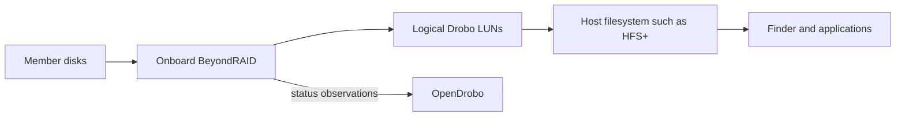

# Firmware capabilities and product opportunities

OpenDrobo has not modified the original Drobo firmware or converted BeyondRAID into another RAID format. The application reads existing management data. The replacement Thunderbolt driver and filesystem components remain inactive research. Original firmware images remain immutable, ignored analysis inputs; their hashes and evidence are recorded in [BeyondRAID layout](../research/BEYONDRAID_LAYOUT.md) and [Thunderbolt transport](../research/THUNDERBOLT_TRANSPORT.md).

## Improvements available from current observations

Statistics can combine protected capacity, OS-used accounting, current physical drive capacity, SSD life and application-observed events into a clearer history. The interface provides actual time ranges, used/free/OS-used charts, utilization, signed allocation changes, observation gaps and retained session-event counts. All byte arithmetic remains exact before chart scaling. Missing readings are not filled; gaps do not establish outages. An observed average allocation change requires at least three readings over one hour with unchanged protected capacity. It is not throughput or a forecast.

Further application features could include user-configured capacity thresholds, SSD-life alerts, event annotations, comparison reports and a previewable diagnostic export. These require explicit retention, notification and redaction behavior. They do not require a firmware rewrite. Current drive telemetry is a snapshot; a long-term per-drive wear history would need a separate bounded recording schema and replacement-drive identity rules.

## Recovered interfaces that need more work

The [original command catalogue](MANAGEMENT_FEATURES.md#original-command-catalogue-recovered) records names, not universal model capabilities or verified executable routes. The original Status interface already had many component views; the opportunity is better history, explanation and correlation.

| Interface evidence | Useful improvement | Required proof before implementation |
| --- | --- | --- |
| `eCmdGetPerformance` (62) | Historical read/write throughput and IOPS where reported | Decode fields, units, sampling and model support; never derive IOPS from capacity changes |
| `eCmdGetEventLogs` (83), `eCmdGetUserEventLog` (91) | Searchable device-log and protection/rebuild timeline | Recover paging, timestamps, record meaning and retention; current Events are application observations only |
| `eCmdGetFanInfo` (63), `eCmdGetPowerInfo` (64) | Component state and change history | Model-specific response schemas; do not invent RPM, temperature units or health labels |
| `eCmdGetControllerCard` (65), `eCmdGetExpanderCard` (66), `eCmdCacheBattery` (67) | Detailed controller, expander and battery information | Confirm hardware presence and supported telemetry on each model |
| `eCmdGetConfig` (30) | Read back actual redundancy, spindown and other supported preferences | Recover each field and capability mask; generic configuration writes remain unavailable |
| `eCmdToggleNightMode` (76) | Optional scheduled light behavior | Recover state and timing semantics and validate on a named spare unit before any automatic command |

Raw temperature, error, status and feature fields are not sufficient to declare health or expose controls. Reset, format, repair, firmware install, arbitrary command execution, file upload and credential-reading interfaces are outside these feature proposals.

## BeyondRAID, filesystems and AppleRAID

Apple's RAID Assistant creates striped RAID 0, mirrored RAID 1 and concatenated JBOD sets from disks exposed to the Mac. It does not replace the onboard BeyondRAID layer. Current recovery has not established a JBOD or raw-member passthrough mode for the home 5D. [Apple's RAID Assistant guide](https://support.apple.com/en-om/guide/disk-utility/dskua23150fd/22.7/mac/27).

Two separate Drobo enclosures could be candidates for a host-managed mirror or stripe, with BeyondRAID still operating inside each. This combination is not implemented or validated by OpenDrobo. Thunderbolt chaining provides connectivity; it does not create a shared BeyondRAID pool. Separate connections offer better fault isolation than depending on the first enclosure to reach the second. A mirror uses one independent enclosure per copy; a stripe can become unavailable when either enclosure is lost.

The large thin-provisioned logical sizes remain a problem for host aggregation. Both actual protected capacities, stable member identities, AppleRAID virtual-member ancestry, mounted-volume detection, disconnect/recovery and safe power behavior would need validation. Mirroring two LUNs from one Drobo retains the same enclosure failure domain. Existing direct-volume mount guards are not certified for an AppleRAID aggregate. A smaller reported block geometry is not a safe conversion for an existing HFS+ volume.

Thin provisioning is implemented by the enclosure's storage firmware below the host filesystem; Thunderbolt transports the exposed logical device. The vendor-authored [5D guide, page 22](https://images-na.ssl-images-amazon.com/images/I/B1sve69GJvS.pdf) explicitly distinguishes virtual volume size from available protected storage. The home pack's 64-TiB logical volume and approximately 11.75-TB protected pool are separate measurements. A Finder statistics adjustment cannot change the block range seen by a host RAID implementation.

Apple's [published mirror rebuild implementation](https://github.com/apple-oss-distributions/AppleRAID/blob/main/AppleRAIDMirrorSet.cpp#L692-L800) copies blocks up to the logical set size. This historical source does not prove current macOS behavior. It identifies a potential full-range rebuild cost; Drobo allocation, zero handling and reclamation remain untested. A bounded host volume or capacity-aware block layer is a research option, not a delivered workaround.

Any experiment must use the separately identified spare enclosures and expendable disks, with explicit permitted writes and recovery evidence. No array conversion, format, member write, firmware change or new mount has been performed.
